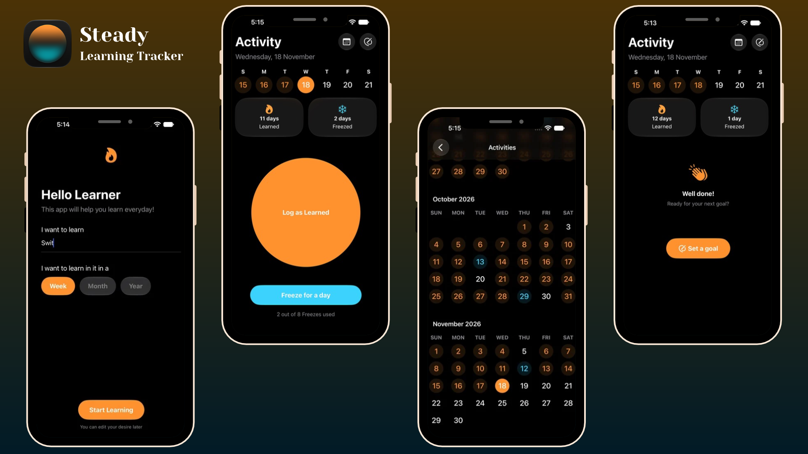

# ✨ Steady

*A little progress every day goes a long way.*

  

**Steady** is a learning habit tracker designed to help you build consistency, stay motivated, and make every day count. Because Building a new habit isn't always easy. Some days you learn, some days you need a break, and that's okay. Steady encourages progress over perfection, one day at a time.

## About the App

Steady helps you turn learning into a consistent daily habit through simple goal tracking, learning streaks, and a flexible freeze-day system.

### 🍃 Features

- 🎯 **Learning Goals:** Set a learning target with a chosen duration.
- 🔥 **Streak Tracking:** Track consecutive learning days and celebrate consistency.
- ❄️ **Freeze System:** Protect your streak with a limited number of freeze days.
- 📅 **Calendar History:** Explore your learning journey through a calendar with your daily logs.
- ✏️ **Goal Management:** Edit your learning target and reset your progress.

## 🛠️ Built With

- **Swift** — Core programming language.
- **SwiftUI** — Declarative UI framework.
- **SwiftData** — Persistent data storage and model management.
- **Observation Framework** — Reactive state management using `@Observable`.
- **ModelContext** — Managing and persisting application data.
- **SwiftUI Property Wrappers** — `@Query`, `@State`, `@Environment`, and `@Bindable`.
- **Apple Liquid Glass** — Native iOS 26 design language.

## 🏗️ Architecture & Data Management

Steady follows the **Model-View-ViewModel (MVVM)** architectural pattern.

- **Model:** SwiftData models representing learning targets and daily logs.
- **View:** SwiftUI views responsible for presenting information and handling user interactions.
- **ViewModel:** Manages application logic, including learning streaks, freeze days, and goal progress.
- **Data Fetching:** Uses SwiftData's `@Query` directly in SwiftUI views for automatic data updates.
- **Persistence:** Uses `ModelContext` to insert, update, delete, and save persistent models.
- **State Management:** Uses the Observation framework and SwiftUI property wrappers to keep the interface synchronized with application state.

## 🎨 Design

Designed with simplicity, clarity, and a little sparkle in mind.

- **Adaptive Appearance:** Supports Light and Dark Mode, adapting the interface to the user's preferred system appearance with app icons using Icon Composer.
- **App Icons:** Light, Dark, and Tinted app icon variants created using Apple's Icon Composer.
- **Liquid Glass:** Uses Apple's native SwiftUI Liquid Glass components for a modern, system-integrated interface.
- **Native Navigation:** Uses SwiftUI navigation components for a familiar iOS experience.
- **Visual Feedback:** Uses distinct colors and symbols to communicate learning streaks, freeze days, and skipped days.
## 🧪 Debug Seed Data

Steady includes a debug-only seed data generator to populate historical activity for development and testing.

- **Historical Data Generation:** Generates sample activity covering the previous three calendar months.
- **Realistic Activity Patterns:** Includes learning streaks, freeze days, and skipped days.
- **Calendar Testing:** Populates historical dates to test monthly calendar layouts and activity visualization.
- **Real Activity:** Today's and future activity remain controlled by the app's normal logging logic.
- **Development Only:** Seed data generation is restricted to Debug builds using `#if DEBUG`.-
